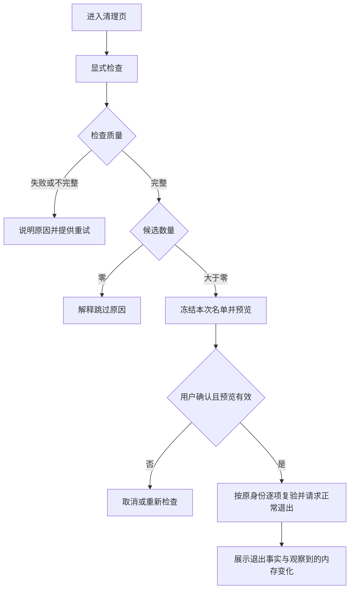

# 用户体验与产品优化实施方案

日期：2026-10-23。设计基线：`4e421a993fa4ba7f922ec70337e64f7238f03a2d`，
应用版本 1.4.2 (142)。本文状态：**U1–U8 候选已实施；复审修复已推送；U7 性能对照、完整人工桌面走查与稳定原生门禁待补**。

目标：用户能快速判断是否需要处理内存，在操作前理解对象与影响，在操作后
看清结果，并在异常时找到下一步。沿用现有原生窗口、菜单栏、采集、历史和
安全机制，通过八个可独立验证的切片交付。

实施交接入口：[给 dsh 的任务说明](dsh-product-experience-handoff.md)。
可靠性基线：[S1–S7 发布记录](release-readiness-s1-s7.md)。

## 1. 执行摘要与边界

### 1.1 本轮要交付什么

| 切片 | 用户获得的能力 | 完成判据 |
| --- | --- | --- |
| U1 状态与异常反馈 | 知道当前数据能否使用、按钮为何不可用、异常去哪处理 | 状态映射统一，错误直达对应区域，技术指标可折叠 |
| U2 概览与菜单栏 | 一眼判断是否需要处理，而不只看到使用率 | 压力结论、依据、时间和下一步一致 |
| U3 清理完整流程 | 先检查、预览并确认本次对象，再看真实结果 | 名单冻结、零候选不进入退出确认、停止语义明确 |
| U4 授权名单管理 | 管理正在运行和未运行的已授权应用 | 单项撤销可达，身份变化不继承授权 |
| U5 历史追溯 | 了解高峰时的压缩、交换和已记录工作组 | 原始样本可定位，缺失/过期归因明确，无伪造因果 |
| U6 日常操作 | 搜索与列表稳定，页面切换保留上下文，遵循 macOS 习惯 | 搜索匹配可见，键盘可用，外观支持跟随系统 |
| U7 资源开销 | 不需要实时进程数据的页面减少扫描 | 按有效可见页面合并需求，安全采样不降级，有对照报告 |
| U8 组合验收 | 获得可复核的候选版本与使用说明 | 行为、原生、性能、来源证据对应最终源码 |

按 U1 → U2 → U3 → U4 → U5 → U6 → U7 → U8 顺序推进。
U1–U2 可先形成完整可用的小增量；后续切片不要求一次合并成大改动。
表中的顺序表示产品实施优先级，不是漏洞等级。

### 1.2 延续的约束

- 正常退出、手动强制结束、内存测试继续走各自现有确认、身份复验、操作互斥和审计链路。
- 智能清理每次最多八个应用，默认不授权应用；前台、近期活动、CPU 数据不足或忙碌时继续保守跳过。
- `ProcessIdentity`、完整 `CleanupAuthorization`、worker token/generation、共享扫描预算继续生效。
- 审计意图持久化失败、待写队列满、恢复事务未决等状态，继续由底层阻止相应动作。
- 不完整恢复副本不得覆盖当前数据；旧 `prepared` 标记缺少 `currentFiles` 时继续要求人工恢复。
- 保留 24 小时历史与 7 天/最多 200 条审计事件的现有策略；历史不补线、不补造记录。
- UI fixture 的真实执行总闸保持关闭，验证只使用临时数据、mock 或专用测试子进程。
- 保持无网络依赖、无遥测，不新增第三方包，不收集完整命令行、原始工作目录或环境变量。

### 1.3 本轮不包含的产品扩张

自动清理、定时退出、缓存/文件删除、自动重启应用、云同步、远程模型分析、
系统通知，以及 GUI 备份/恢复写入入口均放入后续独立需求。本轮提供只读
存储说明和诊断入口，保留现有 CLI 的完整恢复能力。

不迁移登录项路径，不修改 TCC/系统权限，不进行真实注销/登录或签名资质
配置。版本 bump、部署和对外发布单独决定；U8 验收不会自动安装候选应用。

S7 发布记录记载源码 `82e03c9` 的 388 项非 GUI、7 项原生门禁通过。
这些是既有基线，不能用来证明新增 UX 已通过。本次方案编制未重跑应用门禁。

## 2. 现状依据与实施追踪

以下观察来自基线源码。体验影响是设计判断，尚未经真人可用性测试验证。
链接定位到文件，复核时以固定提交中的类型/方法为准。

| 证据 | 当前实现 | 体验判断 | 实施路径 |
| --- | --- | --- | --- |
| E01 | [DesktopOverview / MemoryUsageRing](../Sources/MemoryMonitorApp/DesktopViews.swift)：216 点使用率圆环，主操作固定为释放内存 | 用户容易关注百分比，缺少行动判断 | U2 |
| E02 | [DesktopRelease](../Sources/MemoryMonitorApp/DesktopRelease.swift)：点击后刷新并弹出确认；零候选也可进入确认；停止/跳过为短标签 | 对等待、对象和停止影响的预期不足 | U3 |
| E03 | 同文件 `CleanupApplicationsSheet` 按 `cleanup.applications` 列表展示，计数来自保存的 `authorizations` | 未运行授权不易逐项管理；名单搜索无匹配时可能留白 | U4、U6 |
| E04 | [DesktopHistory / MemoryTrend](../Sources/MemoryMonitorApp/DesktopHistory.swift)：悬停展示时间与使用率 | 难以追溯高峰时的其他状态 | U5 |
| E05 | [MemoryHistoryRecord](../Sources/MemoryMonitorCore/MemoryMonitorCore.swift)：已有压缩、交换、工作组、归因时间及完整性字段 | 可复用已有数据，首轮无需迁移存储格式 | U5 |
| E06 | [DesktopProcesses / DesktopPreferences](../Sources/MemoryMonitorApp/DesktopViews.swift)：视图内 `@State`，数据变化即重排，仅深/浅外观 | 切页上下文、定位稳定性与系统习惯仍可改善 | U6 |
| E07 | [AdaptiveSamplingPolicy](../Sources/MemoryMonitorCore/MemoryMonitorCore.swift)：面板可见统一约三秒并采进程；[MonitorViewModel](../Sources/MemoryMonitorApp/MemoryMonitorApp.swift) 以可见性请求采样 | 历史/设置页也可能承担完整进程扫描成本 | U7 |
| E08 | `CleanupApplicationsSheet` 直接展示扫描次数、成员、耗时和预算；[DesktopMenuPanel](../Sources/MemoryMonitorApp/DesktopMenuPanel.swift) 的审计错误仅跳到设置首页 | 实现指标突出，用户下一步不够直接 | U1 |
| E09 | [DesktopPreferences](../Sources/MemoryMonitorApp/DesktopViews.swift) 的隐私入口打开系统隐私权限；[HistoryInspector](../Sources/MemoryMonitorCore/HistoryInspection.swift) 已有只读能力 | 本地数据说明与系统权限的含义需要区分 | U1、U6 |

例如，复核 E02、E07：

```sh
git show 4e421a9:Sources/MemoryMonitorApp/DesktopRelease.swift
git show 4e421a9:Sources/MemoryMonitorCore/MemoryMonitorCore.swift
```

需求、测试与提交应沿用 E01–E09、U1–U8、后文 A01–A18 编号关联。
闭环路径为：源码观察 → 用户任务 → 展示/行为规则 → fixture/测试 → 交付证据。

## 3. 共用交互与数据契约

### 3.1 信息层次

每个页面按“当前结论 → 主要依据 → 下一步 → 按需展开详情”组织。
概览优先解释状态；进程页支持定位；清理页承载检查与确认；历史页支持追溯；
设置提供偏好、本地数据与高级工具。菜单栏是快速查看和路由入口。

视觉沿用当前品牌、原生材质、深浅外观、SF Symbols 和已有短动效。
先调整信息层级和交互，不另造主题系统。颜色同时配文字/图标；长文可换行，
异常信息不依赖 hover，详情随时可通过键盘打开。

### 3.2 状态有明确来源

| 状态类别 | 来源与展示规则 |
| --- | --- |
| 系统压力 | 复用现有 `MemoryPressureEvaluator` 结果与系统数据可用性；UI 不按使用率另算一套阈值 |
| 数据质量 | 复用 `MonitorDetailDataStatus` 的 loading/current/partial/retained/failed/unavailable 语义，分别标注采样时间 |
| 动作可用性 | 由 controller 提供带原因的只读投影；底层执行仍独立检查相同条件 |
| 存储健康 | 优先保留 typed error/状态码；需要检查时调用只读 `HistoryInspector`，不解析本地化字符串猜错误 |
| 历史归因 | 使用记录自身的 `workloadsSampledAt`、完整性及估算标记；不拿当前进程状态补历史 |

建议新增独立、可测试的展示类型，例如 `MonitorStatusPresentation`、
`ActionAvailability`、`CleanupPreview`、`HistoricalSamplePresentation`。
名称可随项目风格调整，职责及边界不能省略。

展示层不得拥有退出权限，也不得在 `body`、派生属性或悬停事件中触发扫描。
时间、最新快照与状态作为输入，避免依赖不可控的全局时钟造成测试偶发。
系统与进程的新鲜度分别按已有策略判定，不能直接把进程详情状态套到系统
压力结论上，也不在各页面另定互相冲突的过期阈值。

### 3.3 共享状态与导航

- 将进程查询、排序、系统进程筛选、展开项、滚动定位、历史范围放入窗口会话状态；切页和重开同一窗口保持。
- 搜索词、选中的进程及历史取点仅在当前应用会话内保留；跨重启只保存外观、动效等偏好。
- 语义路由支持直接打开审计、某项诊断、本地数据说明或带筛选的进程页。
- 一次只呈现一个 sheet/确认界面；路由上下文处理后清除，不在重新激活时重放。
- 选中进程按完整身份保存；对象退出后展示不可用，不能自动选中同 PID 的新进程。

### 3.4 文案与时间

区分“已请求退出”“已确认退出”“尚未确认”“已重新启动”。将“释放了 X”
统一表达为“观察到可用内存增加约 X”；占用之和不作为可回收承诺。

近期活动剩余观察时间使用运行时单调时钟。系统/进程/历史时间分别标注。
需要倒计时的可见区域最多每秒更新一次，只更新展示；隐藏后停止计时器。
观察结束表示可以重新检查，不表示届时一定符合退出条件。

## 4. U1：统一状态、异常和下一步

**范围**：展示状态、按钮不可用原因、诊断直达、本地数据说明。
建议改动位置：`SimpleMonitorPresentation.swift`、`DetailFreshness.swift`、
`DesktopNavigation`、`DesktopViews.swift`、`DesktopMenuPanel.swift`、
`IntegrationViews.swift`、view model 的错误映射与必要的新展示文件。

| 场景 | 主界面表达 | 可执行的下一步 |
| --- | --- | --- |
| 等待首个有效系统样本 | 正在读取内存状态 | 显示轻量等待，不显示正常结论 |
| 保留旧进程样本 | 显示上次读取的数据，并标明时间 | 重新读取/查看原因 |
| 部分进程无法读取 | 部分数据暂不可用，已显示可读取部分 | 查看详情，不默认引导提权 |
| 清理扫描失败或超时 | 本次检查未完成，无法确定退出对象 | 重新检查，不表达为没有可清理对象 |
| 操作互斥/冷却 | 指明正在进行的操作或剩余冷却时间 | 跳转当前操作；已有停止入口保持可达 |
| 审计不可用/队列满 | 操作记录受限，相应新退出操作暂停 | 直接打开审计及待写状态；不重发退出动作 |
| 磁盘历史失败，内存样本仍可用 | 实时监测继续，本次历史未能保存 | 查看本地数据状态/重新检查 |
| 恢复事务未决 | 数据恢复尚未完成，相关存储操作已暂停 | 查看恢复说明，保留现场 |
| 旧事务需人工恢复 | 无法验证旧恢复副本，需人工处理 | 查看说明与脱敏诊断，继续保留数据、标记和副本 |

执行中状态优先呈现进度和停止入口；阻断原因针对新动作展示，不能遮住正在
执行的操作。只禁用不具备条件的动作，查看状态、打开说明仍可使用。

扫描次数、成员数、取消延迟、预算耗尽等保留在“技术详情”中。主界面显示
可理解的影响、评估完成度及下一步，不要求用户理解 worker 或事务阶段。

设置增加“本地数据与隐私”：说明本地保留范围、采样受限含义、历史与审计
用途；将系统设置入口明确命名为“系统隐私权限”。不把完全磁盘访问描述为
读取所有进程的通用解决办法。

诊断可提供复制摘要和导出摘要。导出经用户选择目的地，使用新文件、拒绝
覆盖；文件 0600。白名单字段限版本、来源、平台版本/架构、状态码、计数、
采样年龄和耗时；默认排除进程/工作组名称、PID、路径、主机名和原始日志。
取消导出不创建文件。后台不自动导出、上传或复制剪贴板。

只读检查按需异步执行，合并重复请求并丢弃过期结果；检查源不产生产品文件，
检查中数据变化显示“数据正在变化，请重新检查”。与生产维护锁、既有检查
边界协调，不能用 `HistoryStore.load/flush/merge` 充当检查。

**退出条件**：A01、A02、A12、A13；至少覆盖 typed recovery error、部分
样本、队列满和重复路由，确认不会因重试检查发送退出请求。

## 5. U2：概览和菜单栏先回答是否需要处理

**范围**：状态卡、依据、主操作层级与统一时间标记。沿用既有圆环和图表，
将其作为读数而非唯一结论。主要位置：`DesktopOverview`、`MemoryMetrics`、
`DesktopMenuPanel`、`MenuBarStatus`、共用状态展示模型。

| 系统状态 | 标题示例 | 依据与主操作 |
| --- | --- | --- |
| 正常且有效 | 当前内存状态正常 | 显示可用量/最近有效采样；主要入口为查看占用，清理保留为次级入口 |
| 注意且有效 | 内存有些紧张 | 显示现有指标；主操作为查看主要占用，提供检查可退出应用入口 |
| 严重且有效 | 内存紧张，建议检查当前任务 | 主操作为查看主要占用；清理仍需完整检查与确认 |
| 不可用/过期 | 暂时无法判断内存状态 | 时间与读取状态，重新读取入口；不显示无需处理结论 |

文案不宣称已检测到卡顿或已确定责任进程。交换空间仍占用时可以解释“交换
空间可能不会立即回落”，不能仅由存量推断正在交换或已经回收。

本切片不新增实时增长算法。已有记录只能支持它自身的趋势；若需要接入
`RecommendationEngine`，作为后续独立需求，不在 U2 顺便改变压力判定。

菜单栏保留紧凑读数与压力图标，辅助功能值加入压力文字、数据可用性。
弹出面板展示同一状态结论、有效时间和最多一个主要行动，保留主窗口入口。
统一菜单、侧栏和页面中的“历史”命名；不因压力变化主动抢焦点或弹窗。

**退出条件**：A01、A03；概览和菜单栏对同一有效/无效输入结论一致，正常
状态不会把固定清理按钮作为唯一强调操作。

## 6. U3：把检查、预览、执行和结果串成完整流程

**范围**：清理页、只读预览、有限状态反馈和本次结果。
主要位置：`DesktopRelease.swift`、`SmartCleanupController`，以及必要的预览
展示类型。底层正常退出实现、CPU/近期活动策略和身份验证不因 UI 重排而替换。

### 6.1 页面状态与优先级

| 条件 | 主内容/主操作 | 行为 |
| --- | --- | --- |
| 本次操作执行中 | 当前应用、阶段、进度；停止后续请求 | 以实际 controller 阶段为准；等待阶段可跳过等待 |
| fixture 或执行能力关闭 | 演示/当前模式不支持退出操作 | 只展示模拟状态，不开放真实执行 |
| 其他操作占用门闩 | 当前操作进行中 | 明确原因，提供对应页面入口 |
| 审计等安全门闩阻断 | 说明相应新操作暂停 | 可读预览，确认退出不可用，提供诊断入口 |
| 没有授权 | 尚未选择可退出的应用；选择应用 | 打开授权管理，不请求退出 |
| 冷却中 | 距下次检查/执行还需等待的时间 | 尊重现有冷却策略，不通过切页绕过 |
| 清单未知/过期 | 检查可退出应用 | 只启动检查，立即出现等待反馈 |
| 正在检查 | 正在检查应用活动 | 可取消检查；不能出现退出确认 |
| 检查失败/不完整 | 检查未完成 | 显示原因、已评估范围和重试入口；不当作零候选成功 |
| 检查完整但零候选 | 本次没有符合条件的应用 | 展示原因分布及可查看明细；不显示请求退出按钮 |
| 有候选 | 本次可请求退出 N 个应用；查看名单 | 进入冻结的预览，确认后才能执行 |
| 已完成/中断 | 真实结果摘要、本次明细 | 明确是否仍有已发出的请求可能生效 |

上述优先级用于展示。底层 controller 仍在入口和发出请求前重新检查，UI 的
可点击状态不能代替执行授权。`ActionAvailability` 应覆盖现有运行、互斥、
冷却和审计限制，消除按钮可用性与实际拒绝原因不一致的问题。

检查质量来自扫描结果及请求生命周期，不能由候选数量倒推。整体预算耗尽、
取消或扫描失败属于未完成；完整扫描中单个应用读取失败/被保护属于该对象
的跳过原因，不把其他已完整评估的对象一起误标失败。零候选但含读取失败时
说明“可评估范围内无符合条件应用，另有部分应用无法读取”，不宣称全部安全。
测试 runtime 无 metrics 时要显式提供完成/失败状态，不默认把缺失当完整。

### 6.2 本次预览是有限、冻结的对象集合

预览模型至少包含：独立 preview ID、生成时间/单调时刻、检查质量、当前
候选的完整进程身份与完整授权身份、显示名、已读取占用、选中集合、跳过
原因统计。模型不包含可执行闭包或发送原语。

1. 显式检查完成后，按既有排序冻结最多八个候选，默认选中这批对象。
2. 用户可逐项取消；取消后不从第九个对象自动补位。额外候选只提示留待下一次检查。
3. 显示名称、图标、已读取占用和状态；占用注明参考口径，不能显示为预计释放量。
4. 没有选中项时确认不可用。预览首屏始终能看到“请求正常退出 N 个应用”和取消入口。
5. 默认 30 秒后将预览标为需重新检查；这是 UI 的有效期，不是退出授权期限。用单调时钟计算，睡眠/时钟异常也使预览过期。
6. 刷新会生成新 preview ID；旧确认闭包、旧 Task 和晚到结果不能发起新一轮操作。
7. 确认时交给现有执行链路的只能是该 preview 中用户选中的对象；执行前继续核验授权、身份、前台/近期活动、CPU、审计和互斥。
8. 对象状态变化后允许跳过，不能加入新对象或替换成同名/同 PID 进程。应用更新后必须重新授权。

切页、关闭窗口或打开另一确认界面使尚未提交的预览失效；保留原有执行中
关闭窗口的停止语义。取消预览、取消检查都不会发送退出请求。不得自动打开
用户应用来制造候选，也不得通过预览触发强制结束。



### 6.3 首次使用、等待和结果

首次进入以页内说明引导选择应用，不强制启动向导，不默认勾选任何授权。
候选因首次观察或近期活动被保护时，说明“仍需观察，之后可重新检查”；若能
可靠计算，可显示剩余观察时间。到时不自动执行，不承诺必然解除保护。

将“停止”改为“停止后续请求”，将等待阶段的“跳过”改为“跳过等待”。
附近说明“已经发出的退出请求仍可能生效”。应用询问保存时可提示查看该
应用，但不自动切换前台，也不关闭其保存对话框。

结果摘要分为两个事实区：已确认退出/拒绝/等待超时/重新启动/未发送，以及
观察到的可用内存变化和测量状态。保留测量失败、负变化、取消和无明显变化
的原意；不把全局内存波动归为某个应用释放的精确数值。

本次记录默认在存在失败、超时、重新启动或取消时展开；全部正常时可折叠。
已有审计仍是跨会话事实来源，不另写一份未经审计的新“成功历史”。成功
动效继续遵守当前真实收益标记、可见性、系统压力和减少动态效果设置。

**退出条件**：A04–A08、A14；旧 worker token 与受控四请求交错测试继续
通过；退出请求的集合严格为用户确认集合的子集。

## 7. U4：授权名单独立于当前运行清单

**范围**：授权名单的展示、搜索和逐项撤销。保持当前授权集合和完整身份
比较语义；可增加单独的展示元数据，不迁移或弱化授权键。

授权管理分“已授权”“可添加”两个标签；无法评估的运行应用在相应列表中
显示原因，系统保护对象保持不可授权。主页面分别显示保存授权总数、本次
运行且匹配身份的数量、本次符合条件的数量，避免把它们混成一个数字。

| 已授权条目状态 | 表达与操作 |
| --- | --- |
| 正在运行，身份一致 | 名称、当前活动/保护状态；可撤销 |
| 未运行/当前未观察到 | 显示已保存名称或 bundle 标识；可撤销，不自动启动 |
| 观察到同 bundle 标识但完整身份不同 | 原授权标为身份变化，需重新确认；新对象不能继承 |
| 名称元数据缺失 | 使用 bundle 标识作为中性名称；不编造名称、不展示完整路径 |

单项撤销接收保存的完整授权值，不为未运行条目伪造 `ProcessSnapshot`。
撤销在执行期间仍可用，下一次发送前的授权检查继续阻断。执行期间不新增
授权；重新授权只影响后续明确确认，不给当前批次补位。

若增加名称元数据，用单独、版本化的偏好键保存，内容仅服务展示；丢失或
损坏不改变授权判断。元数据不上传，不使用名称、bundle ID 或模糊路径重新
建立授权。旧条目与新身份可分别撤销和授权，不自动清理证据或旧偏好。

搜索按各标签筛选后的结果判断空状态，提供“清除搜索”；区分没有授权、
没有可添加应用、没有搜索结果、正在读取和检查失败。刷新期间保留旧列表，
标明旧数据，避免列表闪空和误认为授权被清除。

**退出条件**：A08、A09；旧偏好兼容、未运行撤销、身份变化、保存失败和
执行中撤销均有覆盖，保存失败不得显示为成功授权/撤销。
若沿用 `UserDefaults`，区分本次会话更新与可验证的持久化；不以 `set` 返回
承诺同步落盘，不为模拟可报告失败而新增一套未经设计的授权存储。

## 8. U5：用既有历史数据追溯高峰

**范围**：原始样本取点、峰值定位、压缩/交换读数、历史工作组与记录覆盖。
主要位置：`DesktopHistory.swift`、`HistoryTrendData`，按需新增纯展示类型。
复用 `MemoryHistoryAnalyzer` 的校验及事件能力，不增加历史文件格式。

### 8.1 从图表到具体记录

- 保留 1/6/24 小时、当前最多 240 个绘图点和超过 120 秒断开的规则。
- 提供“定位最高记录”，定位原始样本，绘图降采样不能影响选中的真实值。
- 悬停可预览；点击可固定，移出图表仍保留；Esc 取消固定。键盘左右移动到相邻原始样本。
- 样本详情展示记录时间、存在时的源采样时间、使用率、压缩量、交换量。
- 压缩/交换增量仅比较间隔不超过 120 秒的相邻有效记录，标明比较区间；断档时不推算速率，不把交换存量差称为 swap-in/out 流量。
- 峰值或固定样本因保留期限移出时明确提示；不跳到无关点冒充原选择。
- 平均值仍是所选时段内有效记录的样本平均，不描述成连续时间加权平均。

### 8.2 工作组只解释已有证据

| 记录载荷 | 展示 |
| --- | --- |
| 完整、有效且时间相符 | 当时记录的主要工作组，默认前三项，可展开其余保存项 |
| 完整性为 false | 当时仅有部分工作组数据，列出的不是完整排行 |
| 完整性或归因时间缺失 | 当时未记录足够的进程归因，不推断应用不存在或已退出 |
| 归因时间无效/过期/与记录不符 | 不展示为该时点的可靠归因，显示不可判断及详情 |
| footprint 为估算口径 | 标明估算；不同口径不直接比较增长 |

载荷有效性与变化结论复用并按需抽取 `MemoryHistoryAnalyzer` 既有校验规则，
不放宽其完整性、时间偏差和相邻观察限制。部分载荷可以带警示只读展示，
不能生成确定的出现、消失或增长结论。

工作组总量是归因之和，可能包含共享部分，且历史只保存有限项。不能将
“进入/离开历史排行”说成启动/退出，也不能把占用最大说成造成卡顿或泄漏。
提供“查看当前同类工作组”时只路由到当前进程页筛选，并标明时间不同；
历史数据没有可执行身份，不能从历史直接退出当前同名应用。

### 8.3 记录覆盖与空状态

显示本范围内实际首末记录、有效样本数及可识别的断档数量。长空白维持
空白，不为了视觉连续补数据。没有来源证据时，断档原因显示未知，不能
直接归因于睡眠、关机或应用退出。

首次使用显示“历史正在积累”；所选范围无记录提供切换到有记录范围；
磁盘失败但有内存样本时显示“当前仅在内存中保留，尚未保存”。区分记录
覆盖不足与系统状态正常，历史范围在会话内保持。

**退出条件**：A10、A11；覆盖原始极值被绘图省略、部分/缺失归因、时间
异常、估算口径变化、空范围与数据过期，图表复杂度保持有界。

## 9. U6：保留工作上下文，遵循原生操作习惯

**范围**：进程与名单搜索、排序稳定、窗口会话、键盘、外观与辅助功能。
主要位置：`DesktopViews.swift`、`DesktopPresentation.swift`、
`DesktopWindow.swift`、`DesktopStyle.swift` 和应用菜单。

### 9.1 找到对象后，不因刷新而失去它

| 场景 | 交互契约 |
| --- | --- |
| 搜索命中工作组成员 | 展开或提供直接可见的命中成员，标明命中数与组内总数；组总占用仍为全组，匹配子集另标口径 |
| 搜索无结果 | 显示查询及清除入口；若系统进程被隐藏，可明确提供显示选项 |
| 实时读数改变排序 | 选中、按下或查看详情期间稳定对象位置；可提供固定排序，解除后保留可识别的滚动锚点 |
| 目标退出或身份变化 | 保留已选对象的失效说明，操作不可用；不能让同位置/同 PID 的新对象承接点击 |
| 切页、收起菜单或重开主窗口 | 保留本次会话的查询、排序、展开、历史范围与可用滚动锚点；不恢复未提交清理预览 |

不能在每轮刷新后滚回列表顶部。排序规则对相同数值使用稳定的身份次序；
读数继续更新，不为固定位置冻结安全状态。名单、搜索、详情的目标一致，
手动进程操作继续按完整身份重新确认。

### 9.2 外观、键盘和入口

- 外观增加“跟随系统”，作为没有已存偏好的新安装默认值。已有深色/浅色选择保持；非法值回到系统，不覆盖有效旧选择。
- `Cmd+,` 打开设置；`Cmd+F` 聚焦当前可搜索区域，没有搜索区域时不打开无关页面。
- Esc 先处理最上层可取消界面，再处理固定历史取点；不把 Esc 解释为终止已发送的退出请求。
- 不拦截文本编辑和输入法组合；Tab/Shift+Tab、Space、Return 可完成主要路径，焦点返回触发入口。
- 状态、禁用原因、展开、选择和图表样本有可读的辅助功能名称/值；不只靠颜色、hover 或动效表达结果。
- 遵守减少动态效果、减少透明度和提高对比度设置，保留文字结果及停止入口。

将“统计”统一为“历史”。压力测试移入设置的“高级工具”，保留独立工具
页面/路由和运行状态。运行时从主窗口及相关菜单能直接返回并停止，不让
导航迁移隐藏正在运行的测试；不改变内存测试的限额、保护和操作互斥。

布局以现有默认 960×650、最小 800×560 验收；检查长应用名、长错误、
较大数字、窄窗口和滚动内容。确认/取消、停止与诊断入口不能因截断不可达。
不另行增加语言包；新增文案跟随现有中文风格。

**退出条件**：A15、A16；fixture 和原生测试覆盖页面/窗口切换、成员匹配、
排序更新时点击、旧外观偏好及压力测试运行中导航。

## 10. U7：按可见需求降低扫描开销

**范围**：监测采样调度和生命周期，不改变进程操作的独立安全采样。
主要位置：`AdaptiveSamplingPolicy`、`MonitorViewModel`、
`DesktopWindowCoordinator`、菜单面板及现有采样管线。

### 10.1 合并消费者需求

通过可见消费者的注册 token 表达系统/进程刷新需求，分别取所有有效需求
中更快的间隔。不能只用当前页面枚举覆盖全局：主窗口和菜单面板可能同时
可见；一个关闭不能撤销另一个的需求。

| 有效可见区域 | 正常时系统采样目标 | 正常时进程采样目标 |
| --- | --- | --- |
| 进程页/当前进程详情 | 约 3 秒 | 约 3 秒 |
| 概览、菜单面板、空闲清理页/名单 | 约 3 秒 | 约 15 秒 |
| 历史、设置、空闲高级工具 | 约 20 秒 | 约 60 秒 |
| 无可见消费者 | 保持约 20 秒 | 保持约 60 秒 |

压力激活时，将上述需求与现有系统 5 秒/进程 10 秒节奏合并，取各自更快者。
活动中的工具若确实需要实时读数，可单独注册有生命周期的需求；不能用
常驻“操作页可见”标志把所有隐藏窗口永久留在高频。

窗口关闭、隐藏、最小化、完全遮挡，菜单关闭、页面切换或消费者释放后，
及时更新/注销需求。进入进程页、显式刷新时补一次所需样本；多次刷新合并
到最新请求，不创建并行扫描。恢复可见性时按数据年龄补采，不重放已取消请求。

### 10.2 监测读数和安全判断保持独立

- 清理检查、确认后发送前的 CPU/活动/身份复验继续使用其既有安全采样，不用 15/60 秒监测缓存证明空闲。
- 手动进程操作和内存测试的独立保护继续生效；显示刷新频率不改变任何退出条件。
- 保留单 worker、generation/epoch、取消传递、旧结果丢弃及请求预算；不通过 body、悬停或每个列表行各自扫描。
- 系统采样成功不能刷新进程数据的采样时间；稀疏进程读数显示真实年龄/部分状态。
- 历史写入和工作组完整性继续反映实际采样；不能为凑记录覆盖伪造新鲜工作组。

### 10.3 用对照证据决定是否接受

同机、相同构建配置，基线与候选交替至少三组：后台每组 10 分钟，概览、
进程、历史、设置及窗口/菜单同时可见场景各 3–5 分钟。记录系统负载、
系统版本、架构、采样配置、构建输入与测试源码；两版本有意不同，其他条件
尽量一致。只使用临时数据与专用负载，不退出真实用户应用。

报告包含应用累计 CPU、RSS 起止/峰值、系统/进程采样次数、扫描耗时 P50/P95、
刷新反馈、取消延迟和取消后的残余任务。无法测量的值写明不可用，不能当作
零；不把进程 CPU 等同于整机能耗，不声称精确节电百分比。

接受条件：需求合并和生命周期测试通过；不需实时进程的页面扫描次数按
目标下降；进程页响应及安全复验无退化；没有持续增长的 worker/token。
同条件可重复超过基线 20% 的额外 CPU、RSS 或扫描延迟须调查并解释，不能
单次波动即断言回归，也不能为通过性能验收降低安全采样或隐藏失败。

**退出条件**：A17；报告保留原始计数、采样区间和限制，不以运行一次通过
替代连续对照。若环境不能做性能对照，U7 只能记录为实现待验收。

## 11. U8：组合验收与候选版本交付

### 11.1 验收矩阵

每个 A 编号应关联测试方法、实际结果与证据位置。测试文件名可以调整，
不能仅以总测试数量代替下表覆盖。

| 编号 | 必须成立的行为 | 验证方式 |
| --- | --- | --- |
| A01 | 正常/注意/严重/等待/部分/保留/失败/不可用映射一致，过期和未知不显示正常 | 纯展示投影测试；概览与菜单对同输入比较 |
| A02 | 互斥、冷却、审计队列/存储、扫描异常解释准确，直达正确区域且不会重放路由或退出动作 | 导航与 controller 状态测试；fixture 检查错误入口 |
| A03 | 正常先查看占用；压力显示现有依据；概览和菜单结论、采样年龄一致 | 状态 fixture 与主操作断言，键盘可达 |
| A04 | 首次使用没有授权、不发请求，检查/取消不自动授权 | 空偏好与 RecordingRuntime 测试；页内引导检查 |
| A05 | 完整零候选、部分、失败、超时是不同状态，后几类不能产生可执行预览 | 受控 scanner 结果与空状态测试 |
| A06 | 本次请求对象始终为冻结选择子集，取消不补位；过期、切页、睡眠、新预览及晚到结果不能执行旧名单 | 注入单调时钟、身份与任务交错；记录全部请求并比较完整身份 |
| A07 | 停止只阻止后续请求；跳过等待不撤销已发请求；超时/重启/测量失败/负变化不冒充成功 | 受控 runtime 及结果投影测试；fixture 检查完整文案 |
| A08 | PID 重用、应用更新、前台/CPU/近期活动变化、执行中撤销及审计阻断均按原安全链路拒绝/跳过 | 现有安全回归 + 新冻结预览交错；worker 峰值继续为 1 |
| A09 | 未运行授权可撤销；完整身份不被名称元数据改变；旧偏好、写入失败和搜索空结果准确 | 偏好兼容/失败注入、授权列表投影测试 |
| A10 | 历史完整/部分/缺失/过期/估算载荷区别明确，不制造因果、启动/退出或可执行身份 | 原始记录与 analyzer 规则测试；历史 fixture |
| A11 | 原始峰值和相邻取点准确，120 秒断档不补线/算增量；空范围、保留期限与覆盖提示准确 | HistoryChart/展示模型测试及键盘取点检查 |
| A12 | 只读检查不改源内容、权限、mtime，不调用修复；busy/变化/旧 marker 人工恢复状态不被隐藏 | 临时目录前后文件集合/hash/权限/mtime 对照，受控并发与 typed error |
| A13 | 摘要仅含白名单字段；新文件 0600，取消无产物，目标已存在拒绝覆盖 | 使用带名称/PID/路径等哨兵的数据，检查内容、权限与取消路径 |
| A14 | 生产 UI fixture 执行总闸关闭；所有真实退出验证仅针对本次专用测试子进程 | fixture 路径检查；mock 请求测试与原生专用子进程隔离 |
| A15 | 查询/排序/展开/滚动/历史范围跨切页保持；命中成员可见，刷新点击不换目标 | 会话/列表投影与身份测试，受控刷新原生检查 |
| A16 | 跟随系统兼容旧偏好；键盘、焦点、辅助功能、长文本与最小窗口可完成主路径 | 偏好测试 + fixture/原生桌面矩阵，工具运行中停止可达 |
| A17 | 多可见区域需求合并/释放正确；后台节奏保留，安全采样独立且 worker 无泄漏 | 注入时钟的调度测试、生命周期测试及连续性能对照报告 |
| A18 | 最终源码完整门禁/CI与产物来源一致；失败、skipped、未执行如实保留 | 新证据目录、manifest、独立原生日志、CI URL、provenance 核对 |

### 11.2 自动化与桌面检查分工

纯函数、状态机、偏好兼容和有实际风险的任务交错采用单元测试。退出请求
使用可记录调用的测试 runtime（下称 RecordingRuntime，沿用或扩展现有 mock）；
生产 fixture 始终保持 `executionEnabled=false`，
需要演示成功/失败/等待时注入只读状态，不能为了截图开启真实退出能力。
不添加只复述实现或仅断言静态文案快照的测试。

现有非 GUI 测试与四套原生隔离测试均继续保留。新增原生 case 时同步更新
`verify-native-tests.sh` 的 expected counts 和摘要，不下调原数量、不改 skipped
冒充全绿。原生套件仍独立进程运行，避免 AppKit 全局状态相互污染。

桌面矩阵至少覆盖默认/最小窗口、深/浅/跟随系统、长名称/错误、键盘、
提高对比度、减少透明度和减少动态效果，以及正常、等待、过期、空结果、
失败、身份变化、执行中和结果状态。截图只用隔离 fixture；没有可激活桌面
时保留真实失败并等待原生复核，不给完整门禁标 passed。

建议验证命令如下，由实施者在对应切片或最终验收时运行。本次文档交付
未运行这些命令，也不改变当前入口、沙箱或权限配置。

```sh
# 非 GUI 回归
swift test --skip 'CleanupMotionTests|DesktopMotionTests|SmartCleanupNativeTests|DesktopWindowTests'

# 严格并发 Release 构建
swift build --configuration release -Xswiftc -strict-concurrency=complete

# 隔离桌面检查；仅在主动检查 UI 时启动
./scripts/launch-ui-check.sh --output-dir "$(mktemp -d /private/tmp/mm-ux-ui.XXXXXX)"

# 最终完整门禁，脚本自动创建新证据目录
./scripts/verify-release.sh
```

fixture 启动后记录本次进程和输出目录，检查结束正常停止本次实例；不终止
已安装应用或其他用户进程。完整门禁包含构建、签名、provenance、probe、
桌面报告、四套原生与构建/验证输入稳定性检查。不得用测试筛选或跳过原生
的 artifact gate 代替完整门禁；数量下限只防空跑，不证明覆盖充分。

最终门禁在实现与验证输入已提交、工作区干净时运行。门禁后若只补交付文档，
仍记录实际构建源码提交及输入摘要，不把产物改标为文档 HEAD；若再改变代码、
测试或验证脚本，则按影响重新验证并更新证据，不能沿用旧结果。

### 11.3 产品任务走查

用隔离 fixture 走查展示和导航；涉及授权更新、确认和撤销的完整交互，使用
独立测试宿主接 RecordingRuntime，不开放生产 fixture 的执行能力。按下面
五项任务记录是否完成、误解点和中断位置。实施者先走查；有目标用户参与时
单列其反馈，不能把开发自测称为用户验证。

1. 打开菜单，判断现在是否需要处理，并找到当前主要占用。
2. 首次选择允许退出的应用，检查名单，取消一项并确认其不会被替补。
3. 遇到近期活动、扫描失败、审计阻断时找到原因和下一步。
4. 从历史高峰查看当时记录，能区分缺失数据、交换存量与当前进程。
5. 查找未运行授权并撤销，切页后恢复进程查询，再仅用键盘打开设置。

走查通过要求：没有错误退出对象；能区分未知与正常、已发请求与已确认退出；
每个失败状态能找到重试或诊断入口。若未做真人走查，候选记录中保留该限制，
不以自动化通过推断真实用户理解程度。

### 11.4 与原发布条件衔接

macOS 15 arm64 本地完整门禁及对应 CI 结果记录实际源码；macOS 14 真机/runner、
Developer ID、公证、真实登录/注销与登录项路径迁移仍按 S7 记录单列。它们
不阻止 U1–U7 编码；未完成时不能宣称相应平台/发行条件已验证。

本轮终点为已验收的 UX 候选代码和交付记录；不自动 bump 到 1.5.0 或部署。
若外部条件或本地完整门禁未满足，报告明确区分实现、验证与发布，不把
“代码已提交”写成“可正式发布”。

## 12. 交付切片、技术落点与执行记录

### 12.1 每片完成后再推进

每片内部可拆成更小的可运行提交，保持顺序：刷新 Git/适用指令 → 实施 →
验证受影响行为和合理回归 → 更新文档 → focused commit → push → 下一片。
不把八片积压成一个大提交。必要检查失败时先保留证据并处理；阻塞只暂停
其依赖，不改变安全门闩，不隐藏错误，不执行破坏性 Git 清理。

| 切片 | 主要落点 | 优先复用/扩展的测试 | 依赖 |
| --- | --- | --- | --- |
| U1 | 展示状态、typed error 映射、语义导航、只读诊断 | SimpleInterface、AppIntegration、HistoryInspection、DesktopIntegration | S1–S7 基线 |
| U2 | Overview、MenuPanel、MenuBarStatus、共用状态投影 | SimpleInterface、DesktopPresentation、AppIntegration | U1 |
| U3 | DesktopRelease、SmartCleanupController、预览模型 | SmartCleanup、CleanupCPUActivity、ProcessActionController、SmartCleanupNative | U1–U2 |
| U4 | CleanupApplicationsSheet、完整授权撤销接口、展示元数据 | SmartCleanup、偏好/名单投影 | U3 |
| U5 | DesktopHistory、HistoryTrendData、历史样本展示 | HistoryChart、MemoryMonitorCore、历史 analyzer | U1–U4 |
| U6 | 窗口会话、列表投影、偏好、菜单/焦点、工具入口 | DesktopPresentation、DesktopWindow、DesktopMotion、SimpleInterface | U1–U5 |
| U7 | AdaptiveSamplingPolicy、MonitorViewModel、surface 生命周期 | MemoryMonitorCore、AppIntegration、DesktopWindow、受控 worker | U6 |
| U8 | fixture、必要验证脚本、最终交付记录 | 全量非 GUI + 四套独立原生 + 完整 release gate | U1–U7 |

若新增接口，先用值类型和明确输入输出固定契约：展示只读；清理确认接收
冻结身份子集；授权撤销接收保存的完整授权；采样需求由 token 持有。
不要从页面重新拼装一套退出/存储业务逻辑。

文档更新不得将旧 S7 证据改标为新 UX 结果。最终在新建
`docs/product-experience-delivery.md` 中记录：实际实现提交、产品版本、完整
门禁目录与摘要、原生日志、CI、fixture 截图位置、性能对照及全部限制。
证据目录用新名字并限制权限，不覆盖旧运行，不能提交含真实用户内容的日志。

### 12.2 执行记录

由 dsh 在实际实施后更新，未实施阶段保持下列状态。“未运行”不是失败或通过。

| 阶段 | 当前状态 | 实现提交 | 验收/证据 |
| --- | --- | --- | --- |
| U1 | 已完成 | `659cdef` | 7 项 U1 测试、395 项非 GUI、Release 构建；见 12.2 下方记录 |
| U2 | 已完成 | `926ab20` | 3 项 U2 测试、398 项非 GUI、渲染测试 |
| U3 | 已完成 | `aab8a4b` | 4 项预览测试、402 项非 GUI、清理回归 |
| U4 | 已完成 | `c78bf61` | 5 项授权测试、407 项非 GUI |
| U5 | 已完成 | `cfe9562` | 4 项历史测试、411 项非 GUI |
| U6 | 已完成 | `edf17d4` / `377ac0b` | 会话/稳定排序/实际滚动锚点；423 项非 GUI；滚轮回归 520 点 |
| U7 | 已实现，性能待验收 | `b7d15b7` / `377ac0b` | 需求唤醒/页面恢复修复；5 项调度测试；性能对照未执行 |
| U8 | 候选交付 | `03bdf24` | 完整门禁全绿；5 套原生 8/8；CI 39967122323 |

### U1 实施记录

- 状态：已完成并推送；源码 `659cdef`。
- 统一展示：新增 `MonitorStatusProjection`，覆盖正常/注意/严重/等待/部分/
  保留/失败/不可用；未知和过期不显示正常。
- 异常直达：健康项带 `MonitorHealthRoute`，审计直接打开操作记录，历史直达
  本地数据说明，进程直达进程页；菜单审计错误不再只跳设置首页。
- 动作原因：`ProcessActionController.manualActionAvailability` 与
  `SmartCleanupController.startAvailability` 提供禁用原因；清理技术指标
  折叠到“技术详情”。
- 本地数据：新增只读 `LocalDataDiagnosticsController` 和 `LocalDataPanel`；
  只调用 `HistoryInspector`，不修复/清空/上传；未完成恢复标记可见。
- 脱敏摘要：新增 `SupportSummary` 与 0600、拒绝覆盖的导出；白名单仅版本、
  平台、状态、计数和 issue code，不含名称、PID、路径或原始日志。
- 验证：`ProductExperienceU1Tests` 7 项通过；非 GUI `swift test` **395 项**
  通过；Release 严格并发构建通过。未做真人桌面走查，未启动完整门禁。
- 未完成：U2–U8；本片未改变授权、退出、审计或存储安全链路。

### U2–U8 实施记录

- U2 `926ab20`：概览/菜单共用 `MonitorOverviewDecision`，正常状态主行动为
  查看主要占用，有效时间统一；3 项 U2 测试通过。
- U3 `aab8a4b`：新增 `CleanupPreview` 和预览 sheet；完整检查才生成最多 8 个
  候选，取消不补位、30 秒失效，零候选/不完整检查不进入确认；4 项预览测试
  和清理回归通过。
- U4 `c78bf61`：已授权/可添加分栏、独立授权投影、未运行单项撤销、身份变化
  与显示元数据；5 项授权测试通过。
- U5 `cfe9562`：原始峰值/取点、120 秒相邻增量、工作组质量/估算、覆盖与断档；
  4 项历史测试通过。
- U6 `edf17d4`：进程/历史会话状态、搜索命中成员、跟随系统、Cmd+,/Cmd+F、
  高级工具入口；3 项会话测试通过。
- U7 `b7d15b7`：可见面需求合并、3/15/60 秒分层和压力合并；4 项调度测试通过。
  连续 CPU/RSS/扫描性能对照未执行，见
  [product-experience-performance-u7.md](product-experience-performance-u7.md)。
- U8 `9672820`：UI 检查 fixture 兼容维护锁；完整门禁全绿（418 非 GUI、7/7
  原生），CI `39941268345` 成功；交付记录见
  [product-experience-delivery.md](product-experience-delivery.md)。
- 未完成：U7 连续性能对照、完整人工桌面矩阵/五条任务走查、macOS 14、
  Developer ID/公证、真实登录/注销和部署。未 bump 版本。

### U3/U5/U6/U7 复审修复记录（2026-10-23）

- `c687ded`：预览确认重新读时并由 controller 校验 preview ID/有效期；
  历史归因偏差超过 300 秒标 unknown；可见需求变化唤醒采样；隐藏/恢复保留
  实际页面；U6 稳定排序与滚动锚点。
- 验证：非 GUI **422 项**通过；完整门禁在 `DesktopMotionTests` 因 inactive
  会话失败（证据 `/private/tmp/mm-ux-u8-gate-c687ded`），非原生 artifact gate
  通过（`/private/tmp/mm-ux-u8-gate-c687ded-noskip`）；CI `39955036496`。
- 未完成：U7 连续性能对照、完整人工桌面矩阵、稳定原生门禁、外部发布条件。

### U3/U6 复审补修（2026-10-23）

- `e6d9d9d`：`cancel()`、窗口关闭、切页、预览关闭统一清除
  `activePreviewID`；`start(preview:)` 校验 preview ID/有效期/选中集合。
- U6 列表用 `scrollPosition(id:)` 跟踪实际可见锚点，不再只记录点击行；
  移除了锚点变化时的强制居中，连续滚动不再被拉回；读数刷新保留已有组顺序，
  新增组追加；DesktopWindow 增加连续滚动回归。
- 验证：非 GUI **424 项**通过；滚轮回归 20×26 点=520 点，旧回调注入时
  失败、修复后通过；完整门禁 `/private/tmp/mm-ux-u8-gate-03bdf24-final`
  全绿；5 套原生 8/8；CI `39967122323`。CI 无桌面 runner 跳过 AppKit 滚动宿主。
- 未完成：U7 性能对照、完整人工桌面矩阵、稳定原生门禁、外部发布条件。

### 12.3 回退与后续需求

每片独立提交，必要时以正常 revert 回退该片，保留他人修改和后续依赖；
依赖已变化时先制定定向回退。不使用 reset --hard，不删除历史、备份、
事务标记和旧证据，不重放审计中的退出动作。新增展示元数据或偏好缺失时
保守回到旧显示，不改变授权有效性；U7 不能接受时可恢复原采样策略。

自动清理、通知、GUI 恢复、实时建议引擎、多语言和新历史格式分别进入后续
需求；根据本轮走查与性能证据排序，不在实施时顺带扩大范围。
